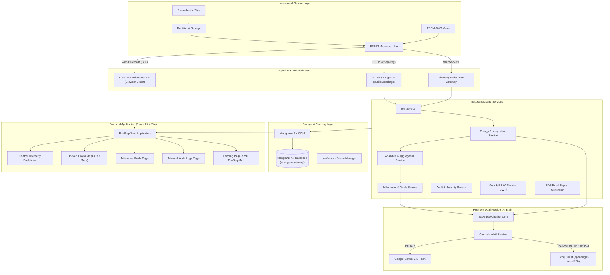

# EcoStep Project Overview, Tech Stack & Architecture Guide

**Project Name:** EcoStep — Smart Footstep Kinetic Energy Monitoring System  
**Document Type:** Technical Architecture, Technology Stack, API & AI Specification  
**Last Updated:** November 10, 2026  
**Repository Path:** `energy-monitoring-system/`  

---

## 1. Project Overview & Objectives

### 1.1 Executive Summary
**EcoStep** is an enterprise-grade IoT energy monitoring platform designed to capture, measure, analyze, and visualize clean kinetic energy harvested from human footsteps. Using piezoelectric floor tiles, bridge rectifiers, capacitors, and IoT microcontrollers, the system converts footstep mechanical compression into measurable electrical energy.

The software platform delivers real-time power analytics, long-term generation trends, dynamic milestone goal tracking, hardware diagnostic health monitoring, automated compliance reporting, and an AI-powered conversational science companion (**EcoGuide**).

### 1.2 Core Physical Principles & Conversion Pipeline
1. **Direct Piezoelectric Effect (Curie Brothers, 1880):** Mechanical stress applied to non-centrosymmetric ceramic lattices (Lead Zirconate Titanate / PZT) displaces internal ion dipoles, generating electrical potential across the tile surfaces.
2. **AC to DC Rectification:** Footstep vibration produces high-voltage AC pulses that pass through Schottky diode bridge rectifiers to produce pulsed direct current.
3. **Capacitive Smoothing & Storage:** Storage capacitors smooth peak ripples and buffer harvested charge before stepping down/up to power low-voltage sensor electronics or charge energy storage.
4. **IoT Measurement & Ingestion:** An **ESP32** microcontroller coupled with a **PZEM-004T** electrical sensor package samples instant voltage ($V$), current ($mA$), power ($mW$), and frequency, pushing telemetry over Wi-Fi / WebSockets or local Bluetooth Low Energy (BLE).
5. **Numerical Energy Integration:** Energy is aggregated through trapezoidal integration over time ($\int P \, dt = \sum \text{Power} \times \text{Time}$) in milliwatt-hours ($mWh$) and kilowatt-hours ($kWh$).

```
[ Human Footsteps ]
        │
        ▼
[ Piezoelectric Floor Tiles (PZT Ceramics) ]
        │ Mechanical stress -> AC pulses
        ▼
[ Bridge Rectifier + Smoothing Capacitors ]
        │ AC -> Smooth DC
        ▼
[ ESP32 Microcontroller + PZEM Sensor ]
        │ Wi-Fi REST / WebSocket (TLS) / BLE
        ▼
[ EcoStep NestJS Backend Engine ]
        │ MongoDB Aggregation & AI Analysis
        ▼
[ EcoStep React 19 Client Dashboard & EcoGuide ]
```

---

## 2. High-Level Architecture & Data Flow



---

## 3. Technology Stack & Frameworks

### 3.1 Backend Stack (`energy-monitoring-system/`)
| Component | Technology | Version | Purpose |
| :--- | :--- | :--- | :--- |
| **Framework** | **NestJS** | `^11.0.1` | Modular, enterprise TypeScript server framework |
| **Runtime** | **Node.js** | `>=20.x` | Event-driven JavaScript runtime |
| **Language** | **TypeScript** | `^5.7.3` | Strongly-typed application code |
| **Database** | **MongoDB** | `^7.x` | Document-oriented NoSQL persistence |
| **ODM** | **Mongoose** | `^9.7.4` | Schema modeling, indexes, and aggregation pipelines |
| **WebSockets** | **Socket.IO** | `^4.8.3` | Real-time bi-directional telemetry streaming |
| **Primary AI SDK** | **@google/generative-ai** | `^0.24.1` | Google Gemini 3.5 Flash client |
| **Fallback AI SDK** | **groq-sdk** | `^1.6.0` | Ultra-low-latency open-weights LLM inference |
| **API Documentation** | **@nestjs/swagger** | `^11.4.6` | OpenAPI 3.0 interactive documentation |
| **Security & Headers**| **Helmet.js** | `^8.3.0` | CSP, XSS, and HTTP security header hardening |
| **Rate Limiting** | **@nestjs/throttler** | `^6.5.0` | IP-based request throttling (chat & APIs) |
| **Authentication** | **Passport + JWT** | `^11.0.2` | Stateless bearer token authentication & RBAC |
| **Password Hashing** | **bcrypt** | `^6.0.0` | Salted credential and access code encryption |
| **PDF Generation** | **PDFKit** | `^0.19.1` | Automated energy compliance PDF reports |
| **Excel Generation**| **ExcelJS** | `^4.4.0` | Multi-sheet analytical spreadsheet export |
| **Date & Timezone** | **date-fns & date-fns-tz**| `^4.4.0 / ^3.2.0` | Precision `Asia/Manila` (UTC+8) calendar handling |
| **Testing Engine** | **Jest + ts-jest** | `^30.0.0` | Unit, integration, and guardrail testing suite |

### 3.2 Frontend Stack (`energy-monitoring-system/frontend/`)
| Component | Technology | Version | Purpose |
| :--- | :--- | :--- | :--- |
| **Core UI Library** | **React** | `^19.2.7` | Component-based interactive UI |
| **Build Tool / Bundler**| **Vite** | `^8.1.1` | Lightning-fast ESM dev server and build bundler |
| **Language** | **TypeScript** | `~6.0.2` | Type-safe client codebase |
| **CSS Framework** | **Tailwind CSS** | `^4.0.0` | Modern utility-first styling with custom theme tokens |
| **Data Fetching** | **@tanstack/react-query** | `^5.101.2` | Cache management, background refetching, queries |
| **Routing** | **React Router DOM** | `^7.18.1` | Client-side routing with role-based navigation guards |
| **Data Charts** | **Recharts** | `^3.9.2` | Responsive SVG time-series and area charts |
| **Formula Rendering**| **KaTeX** | `^0.18.10` | Fast, accessible client-side LaTeX mathematics |
| **Markdown Parsing** | **Marked** | `^18.0.13` | Markdown compiler with math extension |
| **Math Parser Ext** | **marked-katex-extension**| `^5.1.13` | Inline `$...$` and display `$$...$$` math syntax parser |
| **HTML Sanitizer** | **DOMPurify** | `^3.4.15` | XSS protection enabling safe MathML and SVG output |
| **Icons** | **Lucide React** | `^1.25.0` | Unified vector icon family |
| **Hardware Bluetooth**| **Web Bluetooth API** | Native | Direct browser-to-ESP32 BLE telemetry & provisioning |
| **Form Management** | **React Hook Form + Zod**| `^7.82.0 / ^4.4.3`| Validated client forms and schema checks |
| **Testing Engine** | **Vitest + Testing Library**| `^5.0.0 / ^16.3.3` | High-speed component and accessibility tests |

---

## 4. Artificial Intelligence & Cognitive Layer

EcoStep features a centralized dual-provider AI engine ([`GeminiAIService`](file:///c:/Users/Merry%20Apple%20Edano/OneDrive/Desktop/another%20-%20antigrav/energy-monitoring-system/src/ai/gemini-ai.service.ts)) powering both the **Dashboard Real-Time Insights** and the **EcoGuide Conversational Companion**.

```
[ User Query / Sensor Analysis ]
              │
              ▼
   [ Error Classification & Prompt Builder ]
              │
         ┌────┴─────────────────┐
         ▼                      ▼
  [ Google Gemini ]      [ Groq Fallback ]
  (gemini-3.5-flash)     (openai/gpt-oss-120b)
   Primary Provider        Failover Provider
         │                      │
         └──────────┬───────────┘
                    ▼
  [ Output Sanitization & KaTeX Math Parsing ]
                    ▼
           [ Rendered Response ]
```

### 4.1 Automatic Failover Architecture
- **Primary Model:** Google Gemini (`gemini-3.5-flash`). Delivers nuanced physical domain understanding and concise conversational answers.
- **Failover Trigger Classification:** Automatically detects HTTP 429 quota exhaustion, rate limits, request timeouts, and 5xx server errors, instantly rerouting the query to Groq with zero interruption to the user.
- **Failover Model:** Groq Cloud running `openai/gpt-oss-120b`, delivering near-instantaneous inference speeds.
- **Unrounded Precision Guard:** Prevents scientific hallucination by requiring exact floating-point metrics (e.g. $0.648\text{ mW}$) rather than exaggerated numbers.

### 4.2 EcoGuide Persona & Interaction Principles
1. **Witty but Straightforward:** Answers the core question in sentence one. Eliminates filler, academic wind-ups, and artificial bullet-walls.
2. **Everyday Relatability:** Banned all obscure mechanical or vehicular jargon (no odometers, carburetors, or tachometers). Compares concepts exclusively to universally familiar things: smartphone battery percentages, earbuds in a charging case, water flowing into a glass, or coins in a piggy bank.
3. **Structured Formula Presentation:** Pairs plain-English physical meanings alongside exact mathematical notation:
   - $\text{Power} = \text{Voltage} \times \text{Current}$ ($P = V \times I$)
   - $\text{Energy} = \text{Power} \times \text{Time}$ ($E = P \times t$)
4. **Milestone Goal Awareness:** EcoGuide is connected live to [`MilestonesService`](file:///c:/Users/Merry%20Apple%20Edano/OneDrive/Desktop/another%20-%20antigrav/energy-monitoring-system/src/milestones/milestones.service.ts), aware of current monthly targets (e.g. $0.100\text{ mWh}$), active weekly targets, and percentage completion.
5. **Strict Scope Guardrails:**
   - Rejects unrelated political, celebrity, or pop culture trivia.
   - Refuses arbitrary homework math (only EcoStep energy/power calculations allowed).
   - Rejects backend source code inquiries.
   - Refuses disclosure of API keys, tokens, or credentials.

---

## 5. API & Backend Module Catalog

All REST endpoints are grouped under the `/api` global prefix.

```
/api/
├── auth/                 # Authentication & Token Lifecycle
├── admin-management/     # Administrator CRUD & Role Controls
├── audit/                # Immutable Audit Logs & Compliance
├── sensors/              # ESP32 Sensor Registration & API Keys
├── iot/                  # Telemetry Ingestion (ESP32 / PZEM)
├── energy/               # Cumulative Calculations & Readings
├── analytics/            # Historical Aggregations & Trends
├── milestones/           # Monthly & Weekly Goal Management
├── diagnostics/          # Piezoelectric Tile Step Testing
├── chat/                 # Public & Admin EcoGuide Interface
├── reports/              # PDF & Excel Report Engine
├── alerts/               # Threshold Monitoring & System Warnings
├── health/               # Readiness & Liveness Probes
└── public/               # Public Landing Telemetry
```

### 5.1 Endpoint Details

#### 1. Authentication (`/api/auth`)
- `POST /api/auth/login` — Administrator credential login (email/password).
- `POST /api/auth/access-code/validate` — Admin access code authentication.
- `GET /api/auth/profile` — Authenticated profile and role verification.

#### 2. Admin Management (`/api/admin-management`)
- `GET /api/admin-management` — List all administrators with active status.
- `POST /api/admin-management` — Create an administrator (Standard Admin only; Super Admin cannot spawn another Super Admin).
- `PATCH /api/admin-management/:id/status` — Activate or suspend administrator accounts.
- `POST /api/admin-management/:id/reset-code` — Regenerate access code for an admin.

#### 3. Audit & Logs (`/api/audit` & `/api/logs`)
- `GET /api/audit` — Query paginated audit trails with filtering (Authentication, Milestones, Reports, Diagnostics, Chatbot).
- `GET /api/audit/stats` — High-level event counts across categories.

#### 4. Sensors (`/api/sensors`)
- `GET /api/sensors` — List registered hardware sensors, heartbeat status, and signal quality.
- `POST /api/sensors` — Register new ESP32 sensor; generates unique `x-api-key`.
- `PATCH /api/sensors/:id` — Update sensor metadata and physical location.

#### 5. IoT Telemetry Ingestion (`/api/iot`)
- `POST /api/iot/readings` — Ingest single or batch telemetry from ESP32 (`x-api-key` guarded).
- `GET /api/iot/status` — Live sensor connectivity and transmission frequency.

#### 6. Energy (`/api/energy`)
- `GET /api/energy/current` — Latest sensor reading (voltage, current, power, step count).
- `GET /api/energy/today` — Accumulated daily total using trapezoidal numerical integration.
- `GET /api/energy/history` — Historical telemetry range queries.

#### 7. Analytics (`/api/analytics`)
- `GET /api/analytics/comprehensive` — Full telemetry snapshot (today, week, month, peak, environmental impact).
- `GET /api/analytics/timeseries` — Time-series intervals for dashboard charts.
- `GET /api/analytics/impact` — CO₂ emissions avoided and tree equivalents.

#### 8. Milestones & Goals (`/api/milestones`)
- `GET /api/milestones` — Monthly goal, weekly calendar breakdown, progress percentage, and smartphone equivalents.
- `PUT /api/milestones/targets` — Set monthly/weekly targets. Enforces Day 2 locking deadline (Super Admins can execute emergency corrections with audit logging).

#### 9. Hardware Diagnostics (`/api/diagnostics`)
- `POST /api/diagnostics/step-test` — Execute single/multi-footstep diagnostic test.
- `GET /api/diagnostics/baseline` — Compare current output against PZT tile baseline reference.
- `GET /api/diagnostics/history` — Historical health logs.

#### 10. Public Chat & EcoGuide (`/api/chat`)
- `POST /api/chat` — Send query to EcoGuide with session ID continuity. Rate-limited to 20 req/min.

#### 11. Reports (`/api/reports`)
- `POST /api/reports/generate` — Generate downloadable energy report (PDF or Excel).
- `GET /api/reports/:id/download` — Stream generated binary file.

#### 12. Alerts (`/api/alerts`)
- `GET /api/alerts` — Active and acknowledged threshold alerts.
- `PATCH /api/alerts/:id/acknowledge` — Acknowledge alert.

#### 13. Health (`/api/health`)
- `GET /api/health` — Terminus database and server liveness check.

---

## 6. Database Schemas & Data Models (MongoDB / Mongoose)

The platform operates on a single consolidated MongoDB database (`energy-monitoring`).

```
                    ┌─────────────────────────┐
                    │          User           │
                    │   (Admins & Super)      │
                    └────────────┬────────────┘
                                 │ configuredBy
                                 ▼
┌────────────────────────┐  ┌─────────────────────────┐
│         Sensor         │  │     MilestoneTarget     │
│  (ESP32 Device / Key)  │  │   (Monthly / Weekly)    │
└───────────┬────────────┘  └─────────────────────────┘
            │ sensorId
            ▼
┌────────────────────────┐  ┌─────────────────────────┐
│     EnergyReading      │  │        AuditLog         │
│ (V, I, P, Steps, Date) │  │  (Immutable Activity)   │
└────────────────────────┘  └─────────────────────────┘
            │                           │
            ▼                           ▼
┌────────────────────────┐  ┌─────────────────────────┐
│     DiagnosticTest     │  │      ReportRecord       │
│  (Tile Impulse Curves) │  │   (PDF/Excel Artifact)  │
└────────────────────────┘  └─────────────────────────┘
```

### Schema Summary
1. **`users` (`UserSchema`):** Stores administrator credentials, bcrypt password hash, hashed access code, role (`SYSTEM_ADMIN` vs `SUPER_ADMIN`), and activity dates.
2. **`sensors` (`SensorSchema`):** Registered piezoelectric sensor hardware, unique hashed API key, location coordinates, status (`active`, `standby`, `inactive`), and firmware version.
3. **`energy_readings` (`EnergyReadingSchema`):** High-frequency telemetry records:
   - Electrical: `voltage` ($V$), `current` ($mA$), `powerW` ($W$), `energyKWh` ($kWh$).
   - Physical: `stepCount`, `powerFactor`, `frequencyHz`, `batteryLevel`.
   - Quality: `signalQuality` (`excellent`, `good`, `fair`, `poor`), `readingSource` (`hardware`, `mock`).
   - Timestamps: `recordedAt` (ESP32 clock) and `receivedAt` (Server clock).
4. **`milestone_targets` (`MilestoneTargetSchema`):** Singleton document tracking monthly and weekly kinetic goals, configuration locking states, deadline metadata, and immutable Super Admin `correctionLogs`.
5. **`audit_logs` (`AuditLogSchema`):** Security audit events: `administratorId`, `administratorName`, `administratorRole`, `category` (Authentication, Reports, Milestones, Diagnostics, Chatbot), `action`, `status` (`SUCCESS`, `FAILURE`), `ipAddress`, and `userAgent`.
6. **`diagnostic_tests` (`DiagnosticTestSchema`):** Results of physical step calibration tests comparing harvested Joules against reference baseline thresholds.
7. **`reports` (`ReportSchema`):** Metadata, date ranges, parameters, and disk file locations for generated PDF and Excel analytical reports.
8. **`alerts` (`AlertSchema`):** Automatic threshold events (voltage spikes, sensor communication loss).

---

## 7. Security, Governance & Role-Based Access Control (RBAC)

### 7.1 Administrative Roles
- **Standard Administrator (`SYSTEM_ADMIN`):**
  - Full access to operational views: Central Dashboard, Trends, Milestones, Diagnostics, Reports, Sensors, and Settings.
  - Can configure monthly milestone targets once before the Day 2 deadline.
- **Ecostep Super Administrator (`SUPER_ADMIN` / "Ecostep Super"):**
  - **Restricted Dedicated View:** Navigation restricted exclusively to the **Admins** and **Logs** pages. Operational dashboard tabs are removed to provide focused governance.
  - **Single-Tier Safety Hierarchy:** Super Admins cannot create other Super Admins. Only standard administrators can be created.
  - **Milestone Correction Authority:** Can exceptionally adjust locked milestone targets with mandatory reason logging and audit trail generation.

### 7.2 Application Security Measures
- **Helmet.js CSP:** Restricts script execution to origin domains, disabling inline scripts (except for Swagger documentation).
- **Rate-Limiting Guards (`ThrottlerGuard`):** Limits public chat requests to 20 messages per minute per IP address, preventing resource exhaustion on the AI providers.
- **Header Guards:** Sensor endpoints require `x-api-key` validation; administrative endpoints require signed `Bearer <JWT>` tokens.
- **Data Sanitization:** DOMPurify sanitizes all Markdown rendered in the frontend while explicitly whitelisting MathML elements (`<math>`, `<mrow>`, `<mi>`, `<mo>`) and SVG tags.

---

## 8. Frontend Feature Layout & Component Hierarchy

The frontend is organized into modular feature domains:

```
frontend/src/
├── api/                  # Axios HTTP clients and endpoint services
├── assets/               # Logos, SVG assets, and static icons
├── components/
│   ├── common/           # EcoStepLogo, SplashScreen, EmptyStates
│   ├── dashboard/        # Live charts (Power, Steps, Voltage/Current)
│   ├── layout/           # EcoSidebar, MobileNavDrawer
│   └── ui/               # Dialogs, Modals, Buttons
├── contexts/
│   ├── AuthContext       # Token lifecycle and administrator state
│   ├── ThemeContext      # Light and dark theme management
│   └── HardwareStatus    # ESP32 live heartbeat monitor
├── features/
│   ├── admin/            # Diagnostics and Audit Logs pages
│   ├── admin-management/ # Administrator user creation and status toggling
│   ├── ble/              # Web Bluetooth ESP32 provisioning
│   ├── chat/             # Docked EcoGuide (MessageBubble, KaTeX, SuggestionChips)
│   ├── dashboard/        # Central monitoring view with HeroPowerCard
│   ├── landing/          # Public landing page with SVG EcoStepMat
│   ├── milestones/       # Monthly/weekly targets and progress bars
│   └── reports/          # Report configuration and export dialogs
└── styles/               # Design tokens, DM Sans typography, CSS variables
```

---

## 9. Codebase Verification Baseline

As of November 2026, the entire codebase compiles cleanly and passes all validation suites:
- **Backend Build:** `npm run build --prefix energy-monitoring-system` (`nest build`) exits with **code 0**.
- **Backend Unit Tests:** `npm test --prefix energy-monitoring-system` passes 65+ unit tests across `chatbot-core.service.spec.ts`, `gemini-ai.service.spec.ts`, and `chat.controller.spec.ts`.
- **Frontend Build:** `npm run build --prefix energy-monitoring-system/frontend` (`tsc -b && vite build`) bundles in **~2.04 seconds** with **code 0**.
- **Frontend Tests:** `npm test --prefix energy-monitoring-system/frontend` passes all Vitest component suites.

