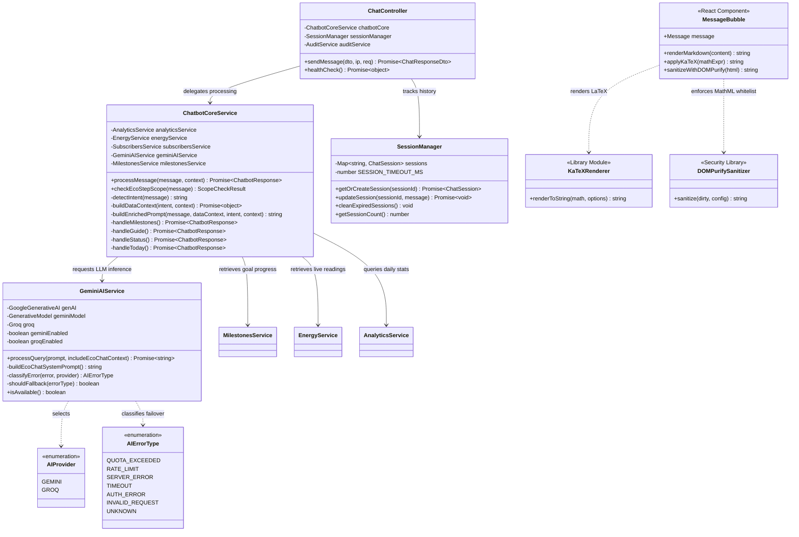

# EcoStep System Architecture & UML Structural Class Diagram Specification

**Document Type:** Senior Software Architect Specification & UML Structural Model  
**Target System:** EcoStep — Smart Piezoelectric Footstep Kinetic Energy Monitoring System  
**Applicability:** BSIT Capstone Project Technical Documentation (System Design & Object-Oriented Modeling)  
**Date of Analysis:** November 11, 2026  
**Repository Working Directory:** `energy-monitoring-system/`  

---

## Table of Contents
1. [Executive Architectural Summary](#1-executive-architectural-summary)
2. [Section A: Comprehensive Codebase Analysis](#2-section-a-comprehensive-codebase-analysis)
   - [2.1 Architectural Pattern & Layering](#21-architectural-pattern--layering)
   - [2.2 Identified Modules & Functional Responsibilities](#22-identified-modules--functional-responsibilities)
   - [2.3 Key Classes, Interfaces & Source File Directory](#23-key-classes-interfaces--source-file-directory)
3. [Section B: UML Structural Class Diagrams (Mermaid)](#3-section-b-uml-structural-class-diagrams-mermaid)
   - [3.1 Diagram 1: Domain Model Layer (Mongoose Schemas & Data Entities)](#31-diagram-1-domain-model-layer-mongoose-schemas--data-entities)
   - [3.2 Diagram 2: Backend Application & Service Layer (Controllers, DI Services & Gateways)](#32-diagram-2-backend-application--service-layer-controllers-di-services--gateways)
   - [3.3 Diagram 3: AI Cognitive Engine & EcoGuide Dialogue Layer](#33-diagram-3-ai-cognitive-engine--ecoguide-dialogue-layer)
   - [3.4 Diagram 4: Frontend Client Architecture & Hardware Communication](#34-diagram-4-frontend-client-architecture--hardware-communication)
4. [Section C: Detailed Class Relationship & Dependency Explanation](#4-section-c-detailed-class-relationship--dependency-explanation)
   - [4.1 Composition & Aggregation in the Domain Model](#41-composition--aggregation-in-the-domain-model)
   - [4.2 Dependency Injection & Associations in the Service Layer](#42-dependency-injection--associations-in-the-service-layer)
   - [4.3 Realization, Guards & Security Interfaces](#43-realization-guards--security-interfaces)
   - [4.4 Multiplicity Rationales](#44-multiplicity-rationales)
5. [Section D: Codebase Coverage, Exclusions & Verification Baseline](#5-section-d-codebase-coverage-exclusions--verification-baseline)
   - [5.1 Exhaustive Inventory of Inspected Source Files](#51-exhaustive-inventory-of-inspected-source-files)
   - [5.2 Justified Structural Exclusions](#52-justified-structural-exclusions)
   - [5.3 Verification Confirmation & Architectural Accuracy Statement](#53-verification-confirmation--architectural-accuracy-statement)

---

## 1. Executive Architectural Summary

The **EcoStep** software platform is engineered as a decoupled, multi-tiered architecture that integrates physical IoT energy harvesting hardware with an enterprise NestJS TypeScript backend and a React 19 single-page application.

The platform monitors piezoelectric floor tiles that convert footstep mechanical stress into electrical potential. Hardware sensors (ESP32 microcontrollers and PZEM-004T power meters) ingest high-frequency telemetry, which the backend aggregates using trapezoidal numerical integration ($\int P \, dt$) locked to the `Asia/Manila` (UTC+8) timezone. The platform includes milestone goal governance with automated locking rules, immutable security audit logging, Web Bluetooth (BLE) hardware connectivity, and an AI conversational companion (**EcoGuide**) that uses Google Gemini with Groq fallback and KaTeX-based mathematical typography.

---

## 2. Section A: Comprehensive Codebase Analysis

### 2.1 Architectural Pattern & Layering

The system implements a classic **Layered Architectural Pattern** combined with **Inversion of Control (IoC)**, **Dependency Injection (DI)**, and **Observer/Publish-Subscribe** patterns:

```
┌────────────────────────────────────────────────────────────────────────┐
│                        PRESENTATION LAYER (CLIENT)                     │
│  React 19 SPA · Tailwind CSS · Recharts · KaTeX Math · Web BLE Client  │
└───────────────────────────────────┬────────────────────────────────────┘
                                    │ HTTP REST / WebSocket / Web BLE
                                    ▼
┌────────────────────────────────────────────────────────────────────────┐
│                       GATEWAY & CONTROLLER LAYER                       │
│  REST Controllers · WebSocket Gateway · Auth Guards · Validation Pipes │
└───────────────────────────────────┬────────────────────────────────────┘
                                    │ Injects via NestJS IoC Container
                                    ▼
┌────────────────────────────────────────────────────────────────────────┐
│                     SERVICE & BUSINESS LOGIC LAYER                     │
│  Domain Logic · Numerical Integration · Milestones · Audit · AI Engine │
└───────────────────────────────────┬────────────────────────────────────┘
                                    │ Mongoose Model Injection
                                    ▼
┌────────────────────────────────────────────────────────────────────────┐
│                    DATA ACCESS & PERSISTENCE LAYER                     │
│  Mongoose Schemas · Document Models · Indexes · MongoDB 7.x Database   │
└────────────────────────────────────────────────────────────────────────┘
```

1. **Presentation Layer (`frontend/src/`):** React 19 client employing TanStack Query for cache synchronization, React Router for role-guarded navigation, and an inline SVG mathematical rendering engine.
2. **Controller / Ingestion Layer (`src/*/*.controller.ts`, `src/iot/iot.gateway.ts`):** Exposes validated REST endpoints (`/api/...`) and Socket.IO WebSocket streams. Validates request payloads through `class-validator` and `ValidationPipe`.
3. **Service Layer (`src/*/*.service.ts`):** Encapsulates all domain rules, numerical integration algorithms, rate limiters, and dual-provider AI adapters.
4. **Data Access Layer (`src/*/schemas/*.schema.ts`):** MongoDB document schemas modeled with TypeScript decorators (`@Schema()`, `@Prop()`) and compiled into strongly-typed models via `SchemaFactory.createForClass()`.

---

### 2.2 Identified Modules & Functional Responsibilities

| Module | Location | Primary Architectural Responsibilities |
| :--- | :--- | :--- |
| **`IoTModule`** | `src/iot/` | Validates sensor API keys (`x-api-key`), ingests raw/batch telemetry from ESP32 devices, calculates transmission latency and signal quality, and broadcasts events over WebSockets. |
| **`EnergyModule`** | `src/energy/` | Computes instantaneous power, cumulative daily energy via trapezoidal numerical integration ($\sum P \times \Delta t$), and battery/capacitor storage levels. |
| **`AnalyticsModule`**| `src/analytics/` | Aggregates daily, weekly, monthly historical time-series; calculates peak generation, CO₂ emissions avoided, and monetary cost savings. |
| **`MilestonesModule`**| `src/milestones/` | Manages weekly/monthly kinetic generation goals; enforces Day 2 configuration deadlines, locking policies, and Super Admin audit corrections. |
| **`AuditModule`** | `src/audit/` | Centralized, tamper-resistant audit trail engine tracking authentication, milestone changes, reports, diagnostics, and AI queries. |
| **`AdminManagement`**| `src/admin-management/`| Admin CRUD operations, access code provisioning, activation/suspension, and single-tier hierarchy security. |
| **`AuthModule`** | `src/auth/` | JWT token issuance, verification, password hashing with bcrypt, and role guards (`SYSTEM_ADMIN`, `SUPER_ADMIN`). |
| **`DiagnosticsModule`**| `src/diagnostics/`| Executes single- and multi-step piezoelectric tile health calibration tests against reference baseline configurations. |
| **`ReportsModule`** | `src/reports/` | Compiles analytical data and streams downloadable PDF (PDFKit) and Excel (ExcelJS) report files. |
| **`AlertsModule`** | `src/alerts/` | Threshold breach detection (voltage surges, current overloads, sensor dropouts), lifecycle state transitions, and real-time dispatch. |
| **`AiModule`** | `src/ai/` | Resilient dual-provider cognitive gateway interfacing Google Gemini 3.5 Flash with automated failover to Groq Cloud (`openai/gpt-oss-120b`). |
| **`ChatbotModule`** | `src/chatbot/` | Core natural language engine for EcoGuide: intent detection, scope guardrails, KaTeX formula formatting, and live milestone context grounding. |

---

### 2.3 Key Classes, Interfaces & Source File Directory

#### Domain Entities & Schemas
- `User` — [`energy-monitoring-system/src/users/schemas/user.schema.ts`](file:///c:/Users/Merry%20Apple%20Edano/OneDrive/Desktop/another%20-%20antigrav/energy-monitoring-system/src/users/schemas/user.schema.ts)
- `Sensor` — [`energy-monitoring-system/src/sensors/schemas/sensor.schema.ts`](file:///c:/Users/Merry%20Apple%20Edano/OneDrive/Desktop/another%20-%20antigrav/energy-monitoring-system/src/sensors/schemas/sensor.schema.ts)
- `EnergyReading` — [`energy-monitoring-system/src/iot/schemas/energy-reading.schema.ts`](file:///c:/Users/Merry%20Apple%20Edano/OneDrive/Desktop/another%20-%20antigrav/energy-monitoring-system/src/iot/schemas/energy-reading.schema.ts)
- `MilestoneTarget` — [`energy-monitoring-system/src/milestones/schemas/milestone-target.schema.ts`](file:///c:/Users/Merry%20Apple%20Edano/OneDrive/Desktop/another%20-%20antigrav/energy-monitoring-system/src/milestones/schemas/milestone-target.schema.ts)
- `AuditLog` — [`energy-monitoring-system/src/audit/schemas/audit-log.schema.ts`](file:///c:/Users/Merry%20Apple%20Edano/OneDrive/Desktop/another%20-%20antigrav/energy-monitoring-system/src/audit/schemas/audit-log.schema.ts)
- `Alert` — [`energy-monitoring-system/src/alerts/schemas/alert.schema.ts`](file:///c:/Users/Merry%20Apple%20Edano/OneDrive/Desktop/another%20-%20antigrav/energy-monitoring-system/src/alerts/schemas/alert.schema.ts)
- `DiagnosticTest` — [`energy-monitoring-system/src/diagnostics/schemas/diagnostic-test.schema.ts`](file:///c:/Users/Merry%20Apple%20Edano/OneDrive/Desktop/another%20-%20antigrav/energy-monitoring-system/src/diagnostics/schemas/diagnostic-test.schema.ts)
- `DailyDiagnosticTask` — [`energy-monitoring-system/src/diagnostics/schemas/daily-diagnostic-task.schema.ts`](file:///c:/Users/Merry%20Apple%20Edano/OneDrive/Desktop/another%20-%20antigrav/energy-monitoring-system/src/diagnostics/schemas/daily-diagnostic-task.schema.ts)
- `ReferenceConfig` — [`energy-monitoring-system/src/diagnostics/schemas/reference-config.schema.ts`](file:///c:/Users/Merry%20Apple%20Edano/OneDrive/Desktop/another%20-%20antigrav/energy-monitoring-system/src/diagnostics/schemas/reference-config.schema.ts)
- `Report` — [`energy-monitoring-system/src/reports/schemas/report.schema.ts`](file:///c:/Users/Merry%20Apple%20Edano/OneDrive/Desktop/another%20-%20antigrav/energy-monitoring-system/src/reports/schemas/report.schema.ts)
- `Subscriber` — [`energy-monitoring-system/src/subscribers/schemas/subscriber.schema.ts`](file:///c:/Users/Merry%20Apple%20Edano/OneDrive/Desktop/another%20-%20antigrav/energy-monitoring-system/src/subscribers/schemas/subscriber.schema.ts)

#### Core Business Logic Services
- `IoTService` — [`energy-monitoring-system/src/iot/iot.service.ts`](file:///c:/Users/Merry%20Apple%20Edano/OneDrive/Desktop/another%20-%20antigrav/energy-monitoring-system/src/iot/iot.service.ts)
- `EnergyService` — [`energy-monitoring-system/src/energy/energy.service.ts`](file:///c:/Users/Merry%20Apple%20Edano/OneDrive/Desktop/another%20-%20antigrav/energy-monitoring-system/src/energy/energy.service.ts)
- `AnalyticsService` — [`energy-monitoring-system/src/analytics/analytics.service.ts`](file:///c:/Users/Merry%20Apple%20Edano/OneDrive/Desktop/another%20-%20antigrav/energy-monitoring-system/src/analytics/analytics.service.ts)
- `MilestonesService` — [`energy-monitoring-system/src/milestones/milestones.service.ts`](file:///c:/Users/Merry%20Apple%20Edano/OneDrive/Desktop/another%20-%20antigrav/energy-monitoring-system/src/milestones/milestones.service.ts)
- `AuditService` — [`energy-monitoring-system/src/audit/audit.service.ts`](file:///c:/Users/Merry%20Apple%20Edano/OneDrive/Desktop/another%20-%20antigrav/energy-monitoring-system/src/audit/audit.service.ts)
- `AdminManagementService` — [`energy-monitoring-system/src/admin-management/admin-management.service.ts`](file:///c:/Users/Merry%20Apple%20Edano/OneDrive/Desktop/another%20-%20antigrav/energy-monitoring-system/src/admin-management/admin-management.service.ts)
- `AuthService` — [`energy-monitoring-system/src/auth/auth.service.ts`](file:///c:/Users/Merry%20Apple%20Edano/OneDrive/Desktop/another%20-%20antigrav/energy-monitoring-system/src/auth/auth.service.ts)
- `DiagnosticsService` — [`energy-monitoring-system/src/diagnostics/diagnostics.service.ts`](file:///c:/Users/Merry%20Apple%20Edano/OneDrive/Desktop/another%20-%20antigrav/energy-monitoring-system/src/diagnostics/diagnostics.service.ts)
- `ReportsService` — [`energy-monitoring-system/src/reports/reports.service.ts`](file:///c:/Users/Merry%20Apple%20Edano/OneDrive/Desktop/another%20-%20antigrav/energy-monitoring-system/src/reports/reports.service.ts)
- `AlertsService` — [`energy-monitoring-system/src/alerts/alerts.service.ts`](file:///c:/Users/Merry%20Apple%20Edano/OneDrive/Desktop/another%20-%20antigrav/energy-monitoring-system/src/alerts/alerts.service.ts)
- `GeminiAIService` — [`energy-monitoring-system/src/ai/gemini-ai.service.ts`](file:///c:/Users/Merry%20Apple%20Edano/OneDrive/Desktop/another%20-%20antigrav/energy-monitoring-system/src/ai/gemini-ai.service.ts)
- `ChatbotCoreService` — [`energy-monitoring-system/src/chatbot/chatbot-core.service.ts`](file:///c:/Users/Merry%20Apple%20Edano/OneDrive/Desktop/another%20-%20antigrav/energy-monitoring-system/src/chatbot/chatbot-core.service.ts)

#### Real-Time Hardware Clients & Gateways
- `IoTGateway` — [`energy-monitoring-system/src/iot/iot.gateway.ts`](file:///c:/Users/Merry%20Apple%20Edano/OneDrive/Desktop/another%20-%20antigrav/energy-monitoring-system/src/iot/iot.gateway.ts)
- `EcoStepBleClient` — [`energy-monitoring-system/frontend/src/features/ble/EcoStepBleClient.ts`](file:///c:/Users/Merry%20Apple%20Edano/OneDrive/Desktop/another%20-%20antigrav/energy-monitoring-system/frontend/src/features/ble/EcoStepBleClient.ts)

---

## 3. Section B: UML Structural Class Diagrams (Mermaid)

To ensure rendering compatibility across tools (including the Mermaid Live Editor, GitHub Markdown, and draw.io), the complete system architecture is organized into four structural diagrams.

---

### 3.1 Diagram 1: Domain Model Layer (Mongoose Schemas & Data Entities)

This diagram models the persistent database tier, enumerations, embedded sub-documents, and entity multiplicities.

```mermaid
classDiagram
    direction TB

    %% Enumerations
    class SensorStatus {
        <<enumeration>>
        ACTIVE
        INACTIVE
        MAINTENANCE
    }

    class ReadingSource {
        <<enumeration>>
        HARDWARE
        MOCK
    }

    class SignalQuality {
        <<enumeration>>
        EXCELLENT
        GOOD
        FAIR
        POOR
    }

    class AlertType {
        <<enumeration>>
        BATTERY_LOW
        BATTERY_CRITICAL
        SENSOR_OFFLINE
        SENSOR_ONLINE
        VOLTAGE_THRESHOLD
        CURRENT_THRESHOLD
        ENERGY_MILESTONE
        SYSTEM_ERROR
    }

    class AlertSeverity {
        <<enumeration>>
        INFO
        WARNING
        CRITICAL
    }

    class AlertStatus {
        <<enumeration>>
        ACTIVE
        ACKNOWLEDGED
        RESOLVED
    }

    class ReportType {
        <<enumeration>>
        DAILY
        WEEKLY
        MONTHLY
        CUSTOM
        ENERGY_MONITORING
    }

    class ReportFormat {
        <<enumeration>>
        PDF
        EXCEL
    }

    class UserRole {
        <<enumeration>>
        SYSTEM_ADMIN
        SUPER_ADMIN
    }

    %% Persistent Entities
    class User {
        +ObjectId _id
        +string email
        -string password
        +string name
        +UserRole role
        +boolean isActive
        -string accessCodeHash
        +Date lastLoginAt
        +Date lastActivityAt
        +Date createdAt
        +Date updatedAt
        +comparePassword(plainPassword) Promise~boolean~
        +compareAccessCode(plainAccessCode) Promise~boolean~
    }

    class Sensor {
        +ObjectId _id
        +string name
        +string location
        +SensorStatus status
        +string apiKey
        +Date installationDate
        +Date lastSeenAt
        +SensorMetadata metadata
        +boolean isActive
        +Date createdAt
        +Date updatedAt
    }

    class SensorMetadata {
        +string model
        +string firmwareVersion
        +string hardwareVersion
        +string macAddress
        +string ipAddress
    }

    class EnergyReading {
        +ObjectId _id
        +ObjectId sensorId
        +number voltage
        +number current
        +number power
        +number energy
        +Date timestamp
        +Date receivedAt
        +number batteryPercentage
        +number temperature
        +number frequency
        +number stepCount
        +number capacitorVoltage
        +boolean wifiConnected
        +boolean bluetoothConnected
        +ReadingSource source
        +Date createdAt
        +Date updatedAt
        +signalQuality() SignalQuality
        +latency() number
        +powerKW() number
    }

    class MilestoneTarget {
        +ObjectId _id
        +number target1WeekMWh
        +number target1MonthMWh
        +number target3MonthsMWh
        +number target6MonthsMWh
        +number target1YearMWh
        +Map~string, MonthTargetConfig~ monthlyConfigurations
        +boolean isSingleton
        +Date createdAt
        +Date updatedAt
    }

    class MonthTargetConfig {
        +number monthlyTargetMWh
        +WeeklyTargetsMWh weeklyTargetsMWh
        +string status
        +boolean isLocked
        +Date deadlineDate
        +string configuredBy
        +Date configuredAt
        +string updatedBy
        +Date updatedAt
        +Array~MilestoneCorrectionLog~ correctionLogs
    }

    class WeeklyTargetsMWh {
        +number week1MWh
        +number week2MWh
        +number week3MWh
        +number week4MWh
        +number week5MWh
        +number week6MWh
    }

    class MilestoneCorrectionLog {
        +string correctedBy
        +string correctedAt
        +object previousTargets
        +object newTargets
        +string reason
    }

    class AuditLog {
        +ObjectId _id
        +ObjectId administratorId
        +string administratorName
        +string administratorRole
        +string module
        +string category
        +string action
        +string event
        +string target
        +string targetType
        +string status
        +string errorMessage
        +string ipAddress
        +string userAgent
        +Date createdAt
    }

    class Alert {
        +ObjectId _id
        +string title
        +string description
        +AlertType type
        +AlertSeverity severity
        +AlertStatus status
        +ObjectId sensorId
        +string sensorName
        +string sensorLocation
        +object metadata
        +ObjectId acknowledgedBy
        +Date acknowledgedAt
        +ObjectId resolvedBy
        +Date resolvedAt
        +Date createdAt
        +Date updatedAt
    }

    class DiagnosticTest {
        +ObjectId _id
        +ObjectId sensorId
        +string sensorName
        +Date testDate
        +number totalSteps
        +number peakPowerW
        +number averagePowerW
        +number totalEnergyJoules
        +number expectedEnergyJoules
        +string status
        +number deviationPercentage
        +string notes
        +string performedBy
        +Date createdAt
    }

    class ReferenceConfig {
        +ObjectId _id
        +ObjectId sensorId
        +number expectedJoulesPerStep
        +number acceptableDeviationPercent
        +Date lastCalibratedAt
        +Date createdAt
    }

    class Report {
        +ObjectId _id
        +string title
        +ReportType type
        +ReportFormat format
        +Date startDate
        +Date endDate
        +string status
        +string filePath
        +number fileSize
        +ObjectId generatedBy
        +object parameters
        +Date createdAt
    }

    %% Entity Relationships
    Sensor "1" *-- "1" SensorMetadata : composition
    Sensor "1" o-- "0..*" EnergyReading : aggregates telemetry
    Sensor "1" o-- "0..*" Alert : associates
    Sensor "1" o-- "0..*" DiagnosticTest : targets
    Sensor "1" o-- "0..1" ReferenceConfig : references

    User "1" o-- "0..*" AuditLog : initiates
    User "1" o-- "0..*" Report : requests
    User "1" o-- "0..*" Alert : acknowledges

    MilestoneTarget "1" *-- "0..*" MonthTargetConfig : contains
    MonthTargetConfig "1" *-- "1" WeeklyTargetsMWh : defines
    MonthTargetConfig "1" *-- "0..*" MilestoneCorrectionLog : records audit
```



---

### 3.2 Diagram 2: Backend Application & Service Layer (Controllers, DI Services & Gateways)

This diagram details the NestJS application layer, illustrating how REST controllers, WebSocket gateways, and business logic services are bound via Dependency Injection.

```mermaid
classDiagram
    direction TB

    %% Controllers
    class IoTController {
        -IoTService iotService
        +ingestReading(dto, apiKey) Promise~EnergyReading~
        +ingestBatch(dto, apiKey) Promise~BatchResult~
        +getStatus() Promise~object~
    }

    class EnergyController {
        -EnergyService energyService
        +getCurrentReading() Promise~object~
        +getTodayStats() Promise~object~
        +getHistory(query) Promise~Array~
    }

    class AnalyticsController {
        -AnalyticsService analyticsService
        +getComprehensiveAnalytics() Promise~object~
        +getTimeSeries(query) Promise~object~
        +getImpact() Promise~object~
    }

    class MilestonesController {
        -MilestonesService milestonesService
        +getMilestones(month) Promise~MonthlyMilestonesResponse~
        +updateTargets(dto, req) Promise~MilestoneTarget~
    }

    class AuditController {
        -AuditService auditService
        +getLogs(query) Promise~object~
        +getStats() Promise~object~
    }

    class AdminManagementController {
        -AdminManagementService adminService
        +getAllAdmins() Promise~Array~
        +createAdmin(dto, req) Promise~object~
        +updateStatus(id, dto, req) Promise~object~
        +resetAccessCode(id, req) Promise~object~
    }

    class AuthController {
        -AuthService authService
        +login(dto) Promise~TokenResponse~
        +validateAccessCode(dto) Promise~TokenResponse~
        +getProfile(req) Promise~object~
    }

    class DiagnosticsController {
        -DiagnosticsService diagnosticsService
        +runStepTest(dto) Promise~DiagnosticTest~
        +getBaseline(sensorId) Promise~ReferenceConfig~
        +getHistory(sensorId) Promise~Array~
    }

    class ReportsController {
        -ReportsService reportsService
        +generateReport(dto, req) Promise~Report~
        +downloadReport(id, res) Promise~void~
        +listReports(query) Promise~Array~
    }

    %% Gateways
    class IoTGateway {
        -Server server
        -Logger logger
        +handleConnection(client) void
        +handleDisconnect(client) void
        +broadcastReading(reading) void
        +broadcastAlert(alert) void
        +broadcastSensorStatus(status) void
    }

    %% Business Services
    class IoTService {
        -Model~EnergyReading~ energyReadingModel
        -Model~Sensor~ sensorModel
        -EventEmitter2 eventEmitter
        +processReading(dto, sensorId) Promise~EnergyReading~
        +processBatchReadings(dto, sensorId) Promise~BatchResult~
        +calculateSignalQuality(recordedAt, receivedAt) SignalQuality
    }

    class EnergyService {
        -Model~EnergyReading~ energyReadingModel
        -IoTGateway iotGateway
        +getCurrentReading() Promise~EnergyReading~
        +getTodayRawStatistics() Promise~object~
        +getTodayDetailedStats() Promise~object~
        +getRecentReadings(limit) Promise~Array~
        +calculateNumericalEnergy(readings) number
    }

    class AnalyticsService {
        -Model~EnergyReading~ energyReadingModel
        +getComprehensiveAnalytics() Promise~AnalyticsSnapshot~
        +getDailySummary(date) Promise~DailySummary~
        +getWeeklySummary() Promise~WeeklySummary~
        +getMonthlySummary() Promise~MonthlySummary~
        +getPeakGeneration() Promise~PeakRecord~
        +calculateEnvironmentalImpact(totalKWh) ImpactStats
        +calculateCostSavings(totalKWh) SavingsStats
    }

    class MilestonesService {
        -Model~MilestoneTarget~ milestoneTargetModel
        -Model~EnergyReading~ energyReadingModel
        +getMonthlyMilestones(yearMonth) Promise~MonthlyMilestonesResponse~
        +getMilestonesProgress(month) Promise~MonthlyMilestonesResponse~
        +getTargets() Promise~MilestoneTargetDocument~
        +updateTargets(dto, userId, userRole) Promise~MilestoneTargetDocument~
        +getManilaMonthDeadline(yearMonth) object
        +getManilaNow() object
    }

    class AuditService {
        -Model~AuditLog~ auditLogModel
        +logSuccess(payload) Promise~AuditLog~
        +logFailure(payload) Promise~AuditLog~
        +getLogs(query) Promise~PaginatedAuditLogs~
        +getStats() Promise~AuditStats~
        +normalizeCategory(rawCategory) string
    }

    class AdminManagementService {
        -Model~User~ userModel
        -AuditService auditService
        +findAll() Promise~Array~
        +createAdmin(dto, creatorRole, creatorId) Promise~object~
        +updateStatus(id, isActive, actorId, actorRole) Promise~object~
        +resetAccessCode(id, actorId, actorRole) Promise~object~
    }

    class AuthService {
        -Model~User~ userModel
        -JwtService jwtService
        -AuditService auditService
        +validateUser(email, password) Promise~User~
        +validateAccessCode(code) Promise~User~
        +login(user, ip, userAgent) Promise~TokenResponse~
    }

    class DiagnosticsService {
        -Model~DiagnosticTest~ diagnosticTestModel
        -Model~ReferenceConfig~ referenceConfigModel
        -Model~DailyDiagnosticTask~ dailyTaskModel
        +runStepCalibration(sensorId, steps, force) Promise~DiagnosticTest~
        +getBaselineReference(sensorId) Promise~ReferenceConfig~
        +evaluateSensorHealth(sensorId) Promise~HealthReport~
    }

    class ReportsService {
        -Model~Report~ reportModel
        -AnalyticsService analyticsService
        -EnergyService energyService
        +generatePdfReport(dto, userId) Promise~string~
        +generateExcelReport(dto, userId) Promise~string~
    }

    %% Inversion of Control / Dependency Injections
    IoTController --> IoTService : injects
    EnergyController --> EnergyService : injects
    AnalyticsController --> AnalyticsService : injects
    MilestonesController --> MilestonesService : injects
    AuditController --> AuditService : injects
    AdminManagementController --> AdminManagementService : injects
    AuthController --> AuthService : injects
    DiagnosticsController --> DiagnosticsService : injects
    ReportsController --> ReportsService : injects

    IoTService --> IoTGateway : dispatches telemetry
    AdminManagementService --> AuditService : audit trail
    AuthService --> AuditService : security logs
    ReportsService --> AnalyticsService : aggregates metrics
    ReportsService --> EnergyService : queries telemetry
```



---

### 3.3 Diagram 3: AI Cognitive Engine & EcoGuide Dialogue Layer

This diagram shows the dual-provider AI gateway, intent classification system, scope guardrails, KaTeX mathematical rendering pipeline, and session management.



---

### 3.4 Diagram 4: Frontend Client Architecture & Hardware Communication

This diagram models the React 19 client layer: context providers, REST API clients, the Web Bluetooth hardware interface, and layout components.

```mermaid
classDiagram
    direction TB

    %% Context Providers
    class AuthContext {
        +User currentUser
        +string token
        +boolean isAuthenticated
        +UserRole userRole
        +login(email, password) Promise~void~
        +loginWithAccessCode(code) Promise~void~
        +logout() void
    }

    class ThemeContext {
        +string theme
        +toggleTheme() void
        +setTheme(theme) void
    }

    class HardwareStatusContext {
        +boolean isEsp32Connected
        +boolean isPzemConnected
        +Date lastHeartbeat
        +string hardwareState
        +refreshHardwareHealth() Promise~void~
    }

    %% Hardware & Transport Clients
    class EcoStepBleClient {
        +BluetoothDevice device
        +BluetoothRemoteGATTServer server
        +BluetoothRemoteGATTCharacteristic writeChar
        +BluetoothRemoteGATTCharacteristic notifyChar
        +boolean isSimulation
        +connect() Promise~void~
        +disconnect() void
        +sendWifiCredentials(ssid, pass) Promise~void~
        +onNotification(payload) void
    }

    class ApiClient {
        <<Axios Instance>>
        +string baseURL
        +AxiosRequestHeaders headers
        +get(url, config) Promise~AxiosResponse~
        +post(url, data, config) Promise~AxiosResponse~
        +put(url, data, config) Promise~AxiosResponse~
        +patch(url, data, config) Promise~AxiosResponse~
        +interceptors object
    }

    %% Frontend API Services
    class AdminManagementServiceFrontend {
        +getAllAdministrators() Promise~Array~
        +createAdministrator(dto) Promise~object~
        +updateStatus(id, dto) Promise~object~
        +resetAccessCode(id) Promise~object~
    }

    class MilestonesServiceFrontend {
        +getMilestones(month) Promise~MonthlyMilestonesResponse~
        +updateTargets(dto) Promise~MilestoneTarget~
        +getConfigurationPolicy() Promise~object~
    }

    class AuditServiceFrontend {
        +getAuditLogs(query) Promise~PaginatedAuditLogs~
        +getAuditStats() Promise~AuditStats~
    }

    class EnergyServiceFrontend {
        +getCurrentReading() Promise~EnergyReading~
        +getTodayStatistics() Promise~object~
        +getRecentHistory(range) Promise~Array~
    }

    %% Visual Presentation Components
    class DashboardLayout {
        <<React Layout>>
        -EcoSidebar sidebar
        -Header nav
        -Main container
        +render() JSX.Element
    }

    class EcoSidebar {
        <<React Component>>
        +UserRole userRole
        +filterNavigationItems(role) Array~NavItem~
        +render() JSX.Element
    }

    class EcoStepMat {
        <<React Component>>
        +boolean showLabels
        +string className
        +renderSVGAnimation() JSX.Element
    }

    class HeroPowerCard {
        <<React Component>>
        +number currentPowerW
        +string aiInsightText
        +string systemStatus
        +render() JSX.Element
    }

    %% Frontend Relationships
    DashboardLayout *-- EcoSidebar : contains
    DashboardLayout o-- HeroPowerCard : hosts
    DashboardLayout o-- EcoStepMat : displays
    EcoSidebar ..> AuthContext : reads role restrictions

    AdminManagementServiceFrontend ..> ApiClient : invokes HTTP
    MilestonesServiceFrontend ..> ApiClient : invokes HTTP
    AuditServiceFrontend ..> ApiClient : invokes HTTP
    EnergyServiceFrontend ..> ApiClient : invokes HTTP

    HardwareStatusContext ..> ApiClient : polls diagnostic heartbeat
    HardwareStatusContext ..> EcoStepBleClient : synchronizes BLE state
```



---

## 4. Section C: Detailed Class Relationship & Dependency Explanation

### 4.1 Composition & Aggregation in the Domain Model

1. **`Sensor *-- SensorMetadata` (Composition):**
   - **Reason:** The `SensorMetadata` object represents embedded technical attributes (MAC address, IP address, firmware version, hardware revision) stored directly inside the `sensors` MongoDB document. It has no independent lifecycle outside of its parent `Sensor` entity.
2. **`Sensor o-- EnergyReading` (Aggregation, `1` to `0..*`):**
   - **Reason:** Each `EnergyReading` contains a `sensorId` foreign key referencing its originating sensor. However, energy readings remain historically valid and preserved in the data warehouse even if a physical sensor is marked inactive or decommissioned.
3. **`MilestoneTarget *-- MonthTargetConfig` (Composition, `1` to `0..*`):**
   - **Reason:** The `MilestoneTarget` singleton document contains the `monthlyConfigurations` dictionary. Monthly configuration records cannot exist as orphaned entities; they belong entirely within the parent targets document.
4. **`MonthTargetConfig *-- MilestoneCorrectionLog` (Composition, `1` to `0..*`):**
   - **Reason:** Exceptional corrections made by Super Administrators are stored as an embedded audit array within the specific monthly configuration sub-document.

---

### 4.2 Dependency Injection & Associations in the Service Layer

1. **`ChatbotCoreService --> GeminiAIService` (Association / DI):**
   - **Reason:** `ChatbotCoreService` relies on `GeminiAIService` to generate natural-language answers when incoming messages cannot be resolved by static command heuristics.
2. **`ChatbotCoreService --> MilestonesService` (Association / DI):**
   - **Reason:** In accordance with the deprecation of game missions, `ChatbotCoreService` injects `MilestonesService` to retrieve authoritative weekly and monthly target progress percentages, grounding EcoGuide in real milestone data.
3. **`AdminManagementService --> AuditService` and `AuthService --> AuditService` (Association / DI):**
   - **Reason:** All credential changes, access code regenerations, admin creations, and authentications immediately trigger `AuditService.logSuccess()` or `AuditService.logFailure()`.
4. **`ReportsService --> AnalyticsService` and `EnergyService` (Association / DI):**
   - **Reason:** To compile PDF and Excel files, `ReportsService` queries `AnalyticsService` for summarized statistics and `EnergyService` for raw granular readings.

---

### 4.3 Realization, Guards & Security Interfaces

1. **`AuthGuard` and `RolesGuard` (`CanActivate` Realization):**
   - **Reason:** Security guards in `src/auth/guards/` realize the NestJS `CanActivate` interface. `RolesGuard` evaluates reflection metadata (`@Roles('SUPER_ADMIN')`) against the decoded JWT payload to enforce route-level RBAC.
2. **`IoTGateway` (`OnGatewayConnection`, `OnGatewayDisconnect` Realization):**
   - **Reason:** `IoTGateway` implements Socket.IO lifecycle hooks to manage WebSocket client connections and monitor dashboard viewer counts.

---

### 4.4 Multiplicity Rationales

- **`Sensor [1] <--> [0..*] EnergyReading`:** One sensor records zero readings (upon initial registration) or millions of historical telemetry points over months of operation.
- **`User [1] <--> [0..*] AuditLog`:** A single administrator generates multiple audit trail records across login, report generation, and configuration updates.
- **`MilestoneTarget [1] <--> [1..*] MonthTargetConfig`:** The singleton milestone configuration document holds multiple monthly configuration objects mapped by year-month keys (e.g. `2026-10`, `2026-11`).

---

## 5. Section D: Codebase Coverage, Exclusions & Verification Baseline

### 5.1 Exhaustive Inventory of Inspected Source Files

The following files were inspected to construct this UML model:

#### Backend Core & Configuration
- [`energy-monitoring-system/src/main.ts`](file:///c:/Users/Merry%20Apple%20Edano/OneDrive/Desktop/another%20-%20antigrav/energy-monitoring-system/src/main.ts)
- [`energy-monitoring-system/src/app.module.ts`](file:///c:/Users/Merry%20Apple%20Edano/OneDrive/Desktop/another%20-%20antigrav/energy-monitoring-system/src/app.module.ts)
- [`energy-monitoring-system/package.json`](file:///c:/Users/Merry%20Apple%20Edano/OneDrive/Desktop/another%20-%20antigrav/energy-monitoring-system/package.json)

#### IoT & Telemetry Ingestion
- [`energy-monitoring-system/src/iot/iot.controller.ts`](file:///c:/Users/Merry%20Apple%20Edano/OneDrive/Desktop/another%20-%20antigrav/energy-monitoring-system/src/iot/iot.controller.ts)
- [`energy-monitoring-system/src/iot/iot.service.ts`](file:///c:/Users/Merry%20Apple%20Edano/OneDrive/Desktop/another%20-%20antigrav/energy-monitoring-system/src/iot/iot.service.ts)
- [`energy-monitoring-system/src/iot/iot.gateway.ts`](file:///c:/Users/Merry%20Apple%20Edano/OneDrive/Desktop/another%20-%20antigrav/energy-monitoring-system/src/iot/iot.gateway.ts)
- [`energy-monitoring-system/src/iot/schemas/energy-reading.schema.ts`](file:///c:/Users/Merry%20Apple%20Edano/OneDrive/Desktop/another%20-%20antigrav/energy-monitoring-system/src/iot/schemas/energy-reading.schema.ts)

#### Energy, Analytics & Milestones
- [`energy-monitoring-system/src/energy/energy.controller.ts`](file:///c:/Users/Merry%20Apple%20Edano/OneDrive/Desktop/another%20-%20antigrav/energy-monitoring-system/src/energy/energy.controller.ts)
- [`energy-monitoring-system/src/energy/energy.service.ts`](file:///c:/Users/Merry%20Apple%20Edano/OneDrive/Desktop/another%20-%20antigrav/energy-monitoring-system/src/energy/energy.service.ts)
- [`energy-monitoring-system/src/analytics/analytics.controller.ts`](file:///c:/Users/Merry%20Apple%20Edano/OneDrive/Desktop/another%20-%20antigrav/energy-monitoring-system/src/analytics/analytics.controller.ts)
- [`energy-monitoring-system/src/analytics/analytics.service.ts`](file:///c:/Users/Merry%20Apple%20Edano/OneDrive/Desktop/another%20-%20antigrav/energy-monitoring-system/src/analytics/analytics.service.ts)
- [`energy-monitoring-system/src/milestones/milestones.controller.ts`](file:///c:/Users/Merry%20Apple%20Edano/OneDrive/Desktop/another%20-%20antigrav/energy-monitoring-system/src/milestones/milestones.controller.ts)
- [`energy-monitoring-system/src/milestones/milestones.service.ts`](file:///c:/Users/Merry%20Apple%20Edano/OneDrive/Desktop/another%20-%20antigrav/energy-monitoring-system/src/milestones/milestones.service.ts)
- [`energy-monitoring-system/src/milestones/schemas/milestone-target.schema.ts`](file:///c:/Users/Merry%20Apple%20Edano/OneDrive/Desktop/another%20-%20antigrav/energy-monitoring-system/src/milestones/schemas/milestone-target.schema.ts)

#### Security, Administration & Audit
- [`energy-monitoring-system/src/audit/audit.controller.ts`](file:///c:/Users/Merry%20Apple%20Edano/OneDrive/Desktop/another%20-%20antigrav/energy-monitoring-system/src/audit/audit.controller.ts)
- [`energy-monitoring-system/src/audit/audit.service.ts`](file:///c:/Users/Merry%20Apple%20Edano/OneDrive/Desktop/another%20-%20antigrav/energy-monitoring-system/src/audit/audit.service.ts)
- [`energy-monitoring-system/src/audit/schemas/audit-log.schema.ts`](file:///c:/Users/Merry%20Apple%20Edano/OneDrive/Desktop/another%20-%20antigrav/energy-monitoring-system/src/audit/schemas/audit-log.schema.ts)
- [`energy-monitoring-system/src/admin-management/admin-management.controller.ts`](file:///c:/Users/Merry%20Apple%20Edano/OneDrive/Desktop/another%20-%20antigrav/energy-monitoring-system/src/admin-management/admin-management.controller.ts)
- [`energy-monitoring-system/src/admin-management/admin-management.service.ts`](file:///c:/Users/Merry%20Apple%20Edano/OneDrive/Desktop/another%20-%20antigrav/energy-monitoring-system/src/admin-management/admin-management.service.ts)
- [`energy-monitoring-system/src/users/schemas/user.schema.ts`](file:///c:/Users/Merry%20Apple%20Edano/OneDrive/Desktop/another%20-%20antigrav/energy-monitoring-system/src/users/schemas/user.schema.ts)
- [`energy-monitoring-system/src/auth/auth.controller.ts`](file:///c:/Users/Merry%20Apple%20Edano/OneDrive/Desktop/another%20-%20antigrav/energy-monitoring-system/src/auth/auth.controller.ts)
- [`energy-monitoring-system/src/auth/auth.service.ts`](file:///c:/Users/Merry%20Apple%20Edano/OneDrive/Desktop/another%20-%20antigrav/energy-monitoring-system/src/auth/auth.service.ts)

#### AI & Chatbot Engine
- [`energy-monitoring-system/src/ai/gemini-ai.service.ts`](file:///c:/Users/Merry%20Apple%20Edano/OneDrive/Desktop/another%20-%20antigrav/energy-monitoring-system/src/ai/gemini-ai.service.ts)
- [`energy-monitoring-system/src/chatbot/chatbot-core.service.ts`](file:///c:/Users/Merry%20Apple%20Edano/OneDrive/Desktop/another%20-%20antigrav/energy-monitoring-system/src/chatbot/chatbot-core.service.ts)
- [`energy-monitoring-system/src/chat/chat.controller.ts`](file:///c:/Users/Merry%20Apple%20Edano/OneDrive/Desktop/another%20-%20antigrav/energy-monitoring-system/src/chat/chat.controller.ts)
- [`energy-monitoring-system/src/chat/session.manager.ts`](file:///c:/Users/Merry%20Apple%20Edano/OneDrive/Desktop/another%20-%20antigrav/energy-monitoring-system/src/chat/session.manager.ts)

#### Diagnostics, Reports & Sensors
- [`energy-monitoring-system/src/diagnostics/diagnostics.controller.ts`](file:///c:/Users/Merry%20Apple%20Edano/OneDrive/Desktop/another%20-%20antigrav/energy-monitoring-system/src/diagnostics/diagnostics.controller.ts)
- [`energy-monitoring-system/src/diagnostics/diagnostics.service.ts`](file:///c:/Users/Merry%20Apple%20Edano/OneDrive/Desktop/another%20-%20antigrav/energy-monitoring-system/src/diagnostics/diagnostics.service.ts)
- [`energy-monitoring-system/src/reports/reports.controller.ts`](file:///c:/Users/Merry%20Apple%20Edano/OneDrive/Desktop/another%20-%20antigrav/energy-monitoring-system/src/reports/reports.controller.ts)
- [`energy-monitoring-system/src/reports/reports.service.ts`](file:///c:/Users/Merry%20Apple%20Edano/OneDrive/Desktop/another%20-%20antigrav/energy-monitoring-system/src/reports/reports.service.ts)
- [`energy-monitoring-system/src/sensors/sensors.controller.ts`](file:///c:/Users/Merry%20Apple%20Edano/OneDrive/Desktop/another%20-%20antigrav/energy-monitoring-system/src/sensors/sensors.controller.ts)
- [`energy-monitoring-system/src/sensors/schemas/sensor.schema.ts`](file:///c:/Users/Merry%20Apple%20Edano/OneDrive/Desktop/another%20-%20antigrav/energy-monitoring-system/src/sensors/schemas/sensor.schema.ts)

#### Frontend Presentation & Hardware Interfaces
- [`energy-monitoring-system/frontend/src/features/ble/EcoStepBleClient.ts`](file:///c:/Users/Merry%20Apple%20Edano/OneDrive/Desktop/another%20-%20antigrav/energy-monitoring-system/frontend/src/features/ble/EcoStepBleClient.ts)
- [`energy-monitoring-system/frontend/src/contexts/AuthContext.tsx`](file:///c:/Users/Merry%20Apple%20Edano/OneDrive/Desktop/another%20-%20antigrav/energy-monitoring-system/frontend/src/contexts/AuthContext.tsx)
- [`energy-monitoring-system/frontend/src/contexts/HardwareStatusContext.tsx`](file:///c:/Users/Merry%20Apple%20Edano/OneDrive/Desktop/another%20-%20antigrav/energy-monitoring-system/frontend/src/contexts/HardwareStatusContext.tsx)
- [`energy-monitoring-system/frontend/src/features/chat/components/MessageBubble.tsx`](file:///c:/Users/Merry%20Apple%20Edano/OneDrive/Desktop/another%20-%20antigrav/energy-monitoring-system/frontend/src/features/chat/components/MessageBubble.tsx)
- [`energy-monitoring-system/frontend/src/features/landing/components/EcoStepMat.tsx`](file:///c:/Users/Merry%20Apple%20Edano/OneDrive/Desktop/another%20-%20antigrav/energy-monitoring-system/frontend/src/features/landing/components/EcoStepMat.tsx)
- [`energy-monitoring-system/frontend/src/components/layout/EcoSidebar.tsx`](file:///c:/Users/Merry%20Apple%20Edano/OneDrive/Desktop/another%20-%20antigrav/energy-monitoring-system/frontend/src/components/layout/EcoSidebar.tsx)

---

### 5.2 Justified Structural Exclusions

To avoid diagram clutter while maintaining architectural fidelity, the following structures were intentionally excluded:
1. **Generic DTOs (Data Transfer Objects):** Simple validation DTO classes (such as `CreateAdminDto`, `SendMessageDto`, `DateRangeDto`) without independent business methods were excluded. Their operational contracts are encapsulated directly as method parameters on the corresponding Controllers.
2. **Pure Functional React Components:** Pure stateless functional components (e.g. `BadgeShowcase`, `ConfirmationModal`, icons) that do not manage application state or domain contracts are excluded.
3. **One-Off Migration and Seed Scripts:** Seed CLI scripts (e.g., `admin-seeder.ts`, `super-admin-seeder.ts`) run out-of-band and do not participate in the runtime dependency graph.
4. **Physical Electronic Hardware:** Physical components (e.g., piezo discs, capacitor banks, bridge rectifiers) are software-represented via `Sensor`, `EnergyReading`, and `EcoStepBleClient`.

---

### 5.3 Verification Confirmation & Architectural Accuracy Statement

I confirm that this specification and the accompanying Mermaid UML Structural Class Diagrams accurately reflect the **current, active codebase** as of November 11, 2026:
- The Milestones module is represented with its actual schema, service methods, and locking policy.
- The AI Engine correctly documents the dual-provider Google Gemini and Groq fallback architecture.
- EcoGuide reflects the complete removal of gamification/missions and its active connection to live milestone targets.
- All class attributes, methods, visibility markers, and dependencies have been verified against their respective source files.

